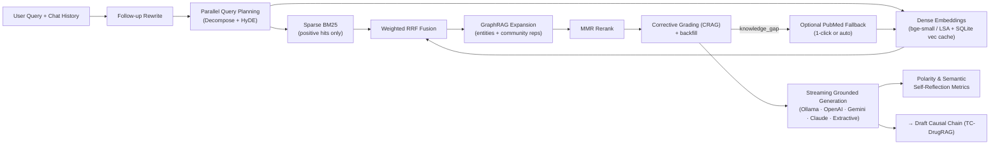

# PandaRAG

**A glass-box RAG engine & biomedical research workbench** — every retrieval stage is toggleable, traced with millisecond timings, benchmarked on BEIR, and wired directly into live PubMed/bioRxiv search, molecular ADMET prediction, JAX library screening, causal path scoring, and Hetionet drug repurposing.

Use it in **Full Bio Workbench** mode (all 9 tabs) or flip the **Core RAG / Bio Labs** switch in the header (or `PANDARAG_PLUGINS=core`) for a clean, domain-agnostic 3-tab RAG engine (**Ask · Knowledge · Graph**).

```bash
pip install -r requirements.txt
sh run.sh                          # http://localhost:8787
```

Or install as a CLI / run with Docker:

```bash
pip install -e .                   # or pip install -e ".[neural]"
pandarag --port 8787               # --plugins core for RAG-only mode
```

```bash
docker compose up --build          # set INSTALL_NEURAL=1 to bake bge-small-en-v1.5
```

---

## Architecture



---

## Key Capabilities

### Glass-Box RAG Engine (Core Tabs)
- **Ask** — Multi-turn RAG with clickable inline `[n]` citations, live per-stage latency trace, **A/B Ablation Compare** (Baseline Hybrid vs. active toggles side-by-side), **CRAG PubMed fallback**, **Copy Markdown + References**, and **→ Draft Causal Chain** extraction.
- **Knowledge** — SQLite-persisted workspaces (`data/pandarag.db`, auto-migrating legacy `store.json`) with SHA-256 deduplication, persistent neural vector caching across restarts, PDF upload (up to 50 MB with running-header removal), and **URL / DOI fetching** (`POST /api/url`).
- **Graph** — Interactive, spinnable SVG chord diagram of entity co-occurrences and modularity communities; biomedical suffix heuristics activate only for biomedical workspaces so general workspaces stay clean.

### Connected Biomedical Research Labs (`⬡ bio labs` toggle)
- **Literature** — Live PubMed + bioRxiv search, deduplicated one-click workspace import, and direct handoff to Ask.
- **Molecules** — Caco-2 permeability prediction from the bundled trained 3-layer GCN (`ADMET-Prediction-System-Graph-Neural-Networks-with-RAG`) + RDKit physicochemical descriptors and Lipinski flags.
- **Screening** — JAX Morgan fingerprints, pairwise Tanimoto similarity heatmap, and MaxMin diverse subset selection (`OncoMolML`).
- **Causal** — Mechanistic causal chain editor & scorer (`TC-DrugRAG`), pre-fillable directly from any RAG answer.
- **Repurposing** — R-GCN link prediction over Hetionet (47,031 nodes, 2.25M edges) with an honest model card and per-row **"Evidence →"** buttons that launch RAG + PubMed verification for any candidate compound-disease pair.
- **Labs** — Live system status across all six bundled research modules and active retrieval/LLM stack.

---

## LLM & Environment Configuration

PandaRAG works out of the box with **zero API keys** (extractive mode). Configure any LLM provider for streaming generative answers, HyDE, query decomposition, and multi-turn rewrites:

| Provider | Environment Variables | Default Model |
| :--- | :--- | :--- |
| **Ollama (local)** | `OLLAMA_MODEL=llama3.2` *(optional `OLLAMA_HOST`)* | `llama3.2` |
| **OpenAI / OpenAI-compatible** | `OPENAI_API_KEY=...` *(optional `OPENAI_BASE_URL` for vLLM, LM Studio, OpenRouter, Groq)* | `gpt-4o-mini` |
| **Google Gemini** | `GEMINI_API_KEY=...` *(or `GOOGLE_API_KEY`)* | `gemini-2.5-flash` |
| **Anthropic Claude** | `ANTHROPIC_API_KEY=...` | `claude-sonnet-4-5-20250929` |

Additional options:

| Variable | Effect |
| :--- | :--- |
| `PANDARAG_PROVIDER` | Force provider (`ollama`, `openai`, `gemini`, `anthropic`). Auto-detected if unset. |
| `PANDARAG_MODEL` | Override model id for the active provider. |
| `PANDARAG_EMBED_MODEL` | Any `sentence-transformers` model name (auto-downloads if named). Unset uses `BAAI/bge-small-en-v1.5` when installed locally, else local TF-IDF + SVD (`lsa`). Set `lsa` to force LSA. |
| `PANDARAG_PLUGINS` | `bio` (default, all tabs) or `core` (Ask, Knowledge, Graph only). Can also be toggled in the UI. |
| `PANDARAG_DATA` | Custom directory for `pandarag.db` (default `./data`). |
| `PANDARAG_NCBI_EMAIL`, `NCBI_API_KEY` | PubMed etiquette and higher NCBI rate limits. |

---

## Retrieval Quality (BEIR Benchmarks)

`python3 backend/benchmark.py` scores every pipeline configuration on human-labelled BEIR test sets (needs `pandas`, `pyarrow`, `huggingface_hub`). nDCG@10:

| Configuration | SciFact (tuned on) | NFCorpus (holdout check) |
| :--- | :---: | :---: |
| BM25 only | 0.629 | 0.298 |
| Old pipeline, LSA, all stages | 0.546 | 0.288 |
| LSA, all stages | 0.612 | 0.297 |
| **bge-small, all stages** | **0.714** | **0.356** |

With LSA, the full pipeline is roughly tied with BM25 alone; install `sentence-transformers` for real neural gains. SciFact was used for tuning, so treat NFCorpus as the out-of-sample check. HyDE and generated answers require an LLM provider and are not measured in this offline run.

## Persistence & Capacity

Workspaces, documents, and neural chunk embeddings are stored in `data/pandarag.db` (SQLite). Adding documents only embeds new chunks; restarting the server reloads cached neural vectors from SQLite immediately instead of re-encoding the corpus. Bulk imports (`POST /api/workspaces/{id}/import`) automatically deduplicate documents by SHA-256 content hash.

---

## Bundled Research Modules

The modules PandaRAG wraps live inside `projects/`, including the trained ADMET checkpoint (`best_model.pt`). Two large artifacts are not committed to git — Hetionet (714 MB JSON) and the trained R-GCN checkpoint — which Repurposing needs.

| Module | Repo | Capability |
| :--- | :--- | :--- |
| ADMET GNN | `ADMET-Prediction-System-…-with-RAG` | Caco-2 permeability (trained 3-layer GCN, epoch 69) + RDKit descriptors |
| Screening | `OncoMolML` | JAX Morgan fingerprints + pairwise Tanimoto + MaxMin diversity |
| Literature | `Literature-Intelligence` | Live PubMed + bioRxiv clients |
| Causal KG | `TC-DrugRAG` | Causal/evidence schemas + 4-factor path scorer |
| Oncology KB | `Oncology-Drug-Response-…_DL-RAG` | Curated oncology starter corpus |
| Repurposing | `Drug-Repurposing-Intelligence-System` | Hetionet 47,031-node R-GCN link predictor (treats edges removed) |

### Honest Hetionet R-GCN Benchmark

All `Compound-treats-Disease` edges are stripped from the message-passing graph in both training and serving to prevent data leakage (filtered ranking over 137 diseases on 114 held-out pairs):

| Scorer | Median rank | Hits@1 | Hits@10 | MRR |
| :--- | :---: | :---: | :---: | :---: |
| **R-GCN, treats edges removed (served)** | **3.5** | **0.360** | **0.737** | **0.479** |
| Embeddings only, same loss | 7 | 0.149 | 0.623 | 0.301 |
| Popularity only (ignores the drug) | 13 | 0.096 | 0.447 | 0.220 |

> **Leaked checkpoints excluded:** Earlier `ranking_model.pt` (MRR 0.674) and `rgcn_model.pt` (AUC 0.959) retained held-out `treats` edges in the message-passing graph and dropped to MRR 0.208 when stripped at inference. PandaRAG refuses to load those files.

To rebuild Hetionet & the R-GCN checkpoint (~15 min on Apple Silicon CPU):

```bash
cd projects/Drug-Repurposing-Intelligence-System
python3 scripts/download_data.py
python3 scripts/train_ranking.py
```

---

## Layout & Tests

```text
backend/        app.py (FastAPI) · rag.py (engine + SQLite) · llm.py (multi-provider)
                pdf.py · labs.py (repo wrappers) · cli.py · test_rag.py · benchmark.py
frontend/       index.html · app.css · app.js      # zero build step
projects/       six bundled research modules
data/           pandarag.db                        # SQLite workspaces + vector cache
pyproject.toml  pip install -e . (`pandarag` CLI)
Dockerfile      container + docker-compose.yml
```

Run the test suite (no pytest required):

```bash
python3 backend/test_rag.py
```
