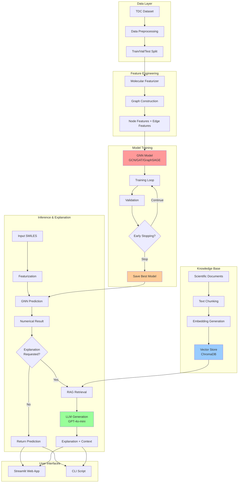
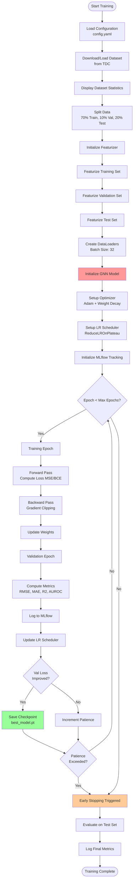
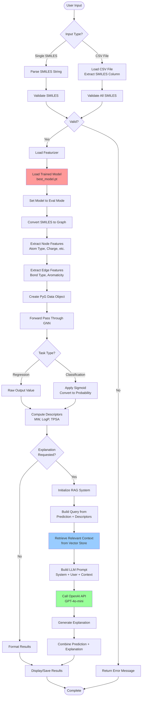
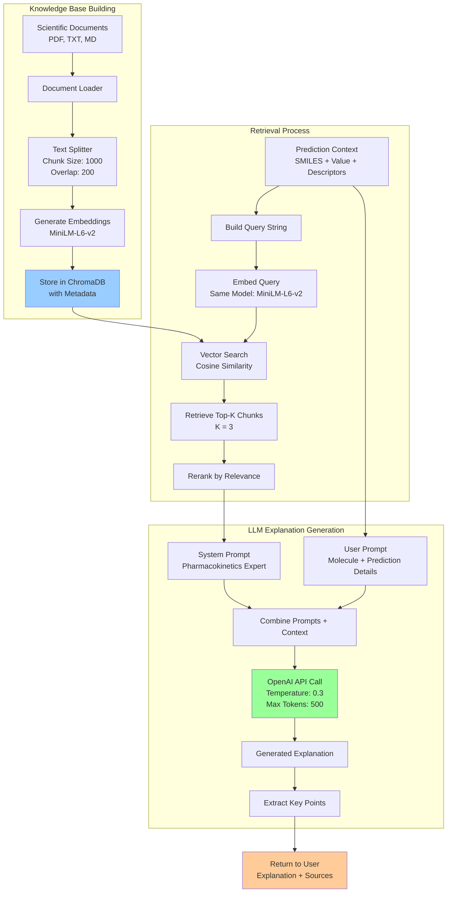
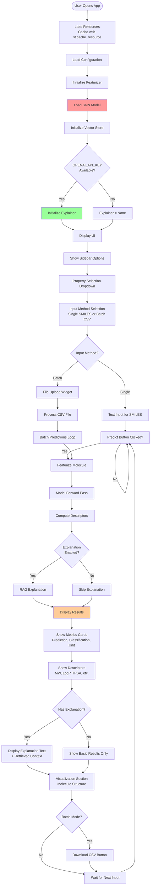
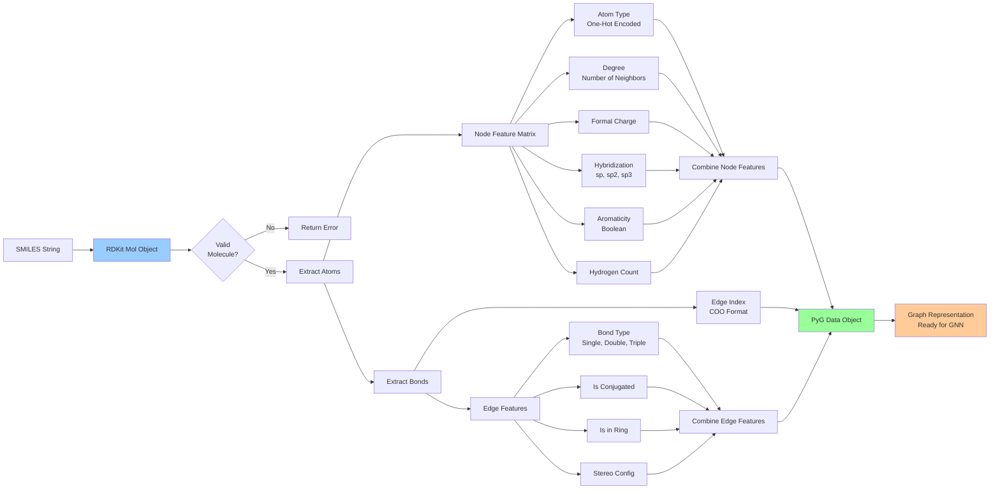
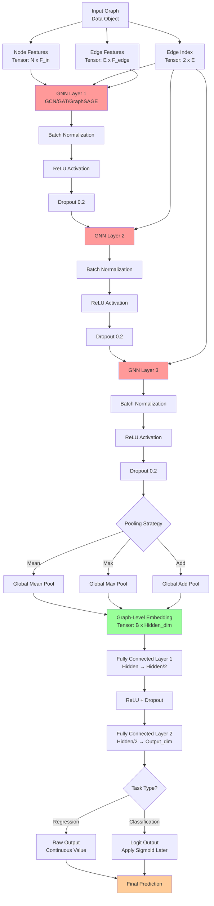

# ADMET Prediction System - Architecture Flowcharts

## 1. Overall System Architecture

## 2. Training Pipeline Flow

## 3. Prediction Pipeline Flow

## 4. RAG System Flow (Knowledge Retrieval & Explanation)

## 5. Streamlit Web Application Flow

## 6. Molecular Featurization Process

## 7. GNN Model Architecture Flow

## Component Descriptions

### Key Components:

1. **Data Layer**: Handles dataset loading from TDC and preprocessing
2. **Featurizer**: Converts SMILES to graph representations with molecular features
3. **GNN Model**: Graph neural network for molecular property prediction
4. **Training Loop**: Manages epochs, validation, early stopping, and checkpointing
5. **Vector Store**: ChromaDB storage for knowledge base embeddings
6. **RAG System**: Retrieves relevant context and generates explanations
7. **Interfaces**: Streamlit web app and CLI scripts for user interaction

### File Mappings:

- `scripts/train_model.py` → Training Pipeline
- `scripts/predict.py` → CLI Prediction Pipeline
- `app/main.py` → Streamlit Application Flow
- `src/data/featurizer.py` → Molecular Featurization
- `src/models/gnn.py` → GNN Architecture
- `src/models/trainer.py` → Training Loop
- `src/rag/vector_store.py` → Knowledge Base Management
- `src/rag/llm_explainer.py` → RAG Explanation System

---

*Generated for ADMET Prediction System - Graph Neural Networks with RAG*
